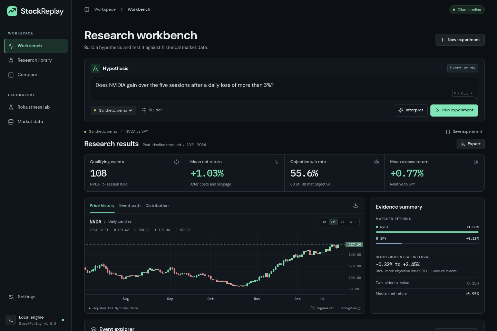

# StockReplay

StockReplay is a local market research laboratory. Write an investment hypothesis, review the rules inferred by Ollama, and run them against historical daily prices. The Python engine calculates every observation, return and confidence interval. Each experiment keeps the exact data snapshots used in the calculation.



## Launch

On macOS or Linux, run the following in a terminal.

```bash
git clone https://github.com/FunctionalTools/stockreplay.git
cd stockreplay
./setup.sh
./start.sh
```

The launcher opens **http://127.0.0.1:8765**. If the port is occupied, use the address printed by the launcher. Run `./stop.sh` to stop the services started by this checkout. First setup downloads dependencies and a local model. Cached experiments, imports, reports and the builder work offline. No account or API key is required.

## Run a real-data experiment

1. Choose **New experiment**. The data source defaults to **Yahoo Finance**. The opening workbench is a separate, labeled synthetic example.
2. Enter “Does NVIDIA have a positive five-session return after a daily loss greater than 3%?” and choose **Interpret**.
3. Inspect the traded ticker, benchmark, dates, signed entry threshold, holding period and costs. Edit them in the builder. Choose **Run experiment**.
4. Inspect **Research results**. The price chart exposes adjusted daily candles, the event path shows the matched benchmark, and **Distribution** shows net returns. A portfolio backtest plots daily equity.
5. Open **Counterexamples** and inspect an individual observation. The chart marks its signal, entry and exit. Failed outcomes stay in the event table and exports.
6. Open **Robustness lab** and run the sensitivity grid. Compare in-sample results with holdout performance and expanding-window folds.
7. Choose **Save experiment** to add a name and notes. **Export** offers HTML, event CSV, configuration JSON, and a portable experiment containing the original data. Import that file from **Research library** to reproduce the run offline.

The builder works independently of Ollama. The initial synthetic study also provides a reproducible demonstration with no provider request. On the bundled data, its default settings produce **108 events** and a **+1.03% mean net return**. These numbers describe the generated series.

## Supported research

| Area | Capabilities |
| --- | --- |
| Signals | Daily and cumulative return, streaks, SMA distance and crossovers, Cutler RSI, volume and relative volume, volatility, drawdown, benchmark-relative returns, and cross-stock triggers |
| Execution | Event studies with overlapping observations, long-only portfolio backtests with cash and equal starting allocations, close-based signals, next-open entry, fixed or conditional exits, commission and slippage |
| Inference | Event counts, mean and median returns, outcome frequency, paired benchmark returns, worst and best observations, time-block bootstrap intervals and p-values |
| Robustness | Threshold and holding-period heatmaps, cost sensitivity, adjustable assets, date ranges and regimes, chronological holdouts, expanding walk-forward selection |
| Data | Yahoo Finance via yfinance, explicit CSV import/export, dividends and splits, adjusted OHLC, US session coverage checks, immutable price snapshots and offline replay |
| Research library | Save, rename, duplicate, revise, rerun, compare and delete saved work. Comparison reports and notes persist in SQLite |
| Exports | PNG candlesticks, SVG performance and distribution charts, CSV, JSON, portable snapshots and self-contained HTML |

### Example hypotheses

- Does Microsoft outperform SPY over the next three sessions after NVIDIA drops more than 4% in one session?
- Does Apple outperform SPY over five trading sessions after three consecutive daily losses?
- Do NVDA’s next five sessions have positive returns when volume exceeds twice its previous 20-session average?
- For a portfolio split between AAPL and MSFT, what happens when the 20-session SMA crosses above the 50-session SMA and each position is held for ten sessions?

A full recovery, a positive net return and benchmark outperformance are different objectives. Review the interpreted objective before execution. Questions requiring earnings, headlines, intraday bars or a point-in-time sector membership dataset need additional data.

## Documentation

- [Installation, model selection and troubleshooting](docs/INSTALLATION.md)
- [System architecture and persistence](docs/ARCHITECTURE.md)
- [Statistical methodology and limitations](docs/METHODOLOGY.md)
- [Market data, attribution and third-party notices](docs/DATA.md)
- [Build and verification record](BUILD_LOG.md)
- [Counterexample inspection](docs/screenshots/counterexample.png) · [Robustness lab](docs/screenshots/robustness.png) · [Mobile workbench](docs/screenshots/mobile.png)

## Verification

```bash
.venv/bin/python -m pytest -q
npm --prefix frontend test
npm --prefix frontend run build
npm --prefix frontend run e2e
```

Set `STOCKREPLAY_LIVE_TESTS=1` for the real Yahoo and installed Ollama tests. Browser tests start an isolated backend with a temporary database. They use system Chromium or the Playwright browser installed by setup. Details for alternate models and browser paths are in the installation guide.

StockReplay source code and its generated demonstration series are available under the [MIT License](LICENSE).
