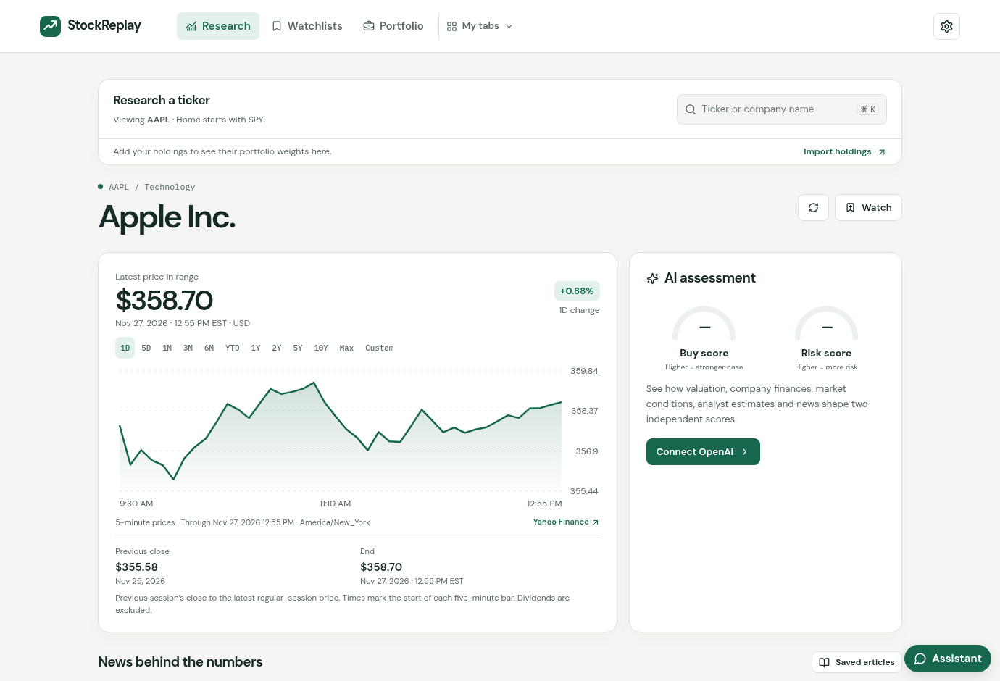

# StockReplay for macOS

StockReplay is a stock research website that runs on your Mac. Search a ticker to see its latest completed close, read the articles behind a stock assessment, and compare published analyst opinions. Your watchlists, portfolio statements, custom tabs, saved articles and assistant conversations live in a local SQLite database.



## Open StockReplay

On an Apple Silicon or Intel Mac, clone the repository and launch the app.

```bash
git clone https://github.com/FunctionalTools/stockreplay.git
cd stockreplay
./StockReplay.command
```

You can also double-click **StockReplay.command** in Finder. The first launch installs the dependencies, builds the website and opens your browser. To update an existing checkout, run `git pull --ff-only origin main` and open **StockReplay.command** again. The launcher checks for changed application files and rebuilds as needed. Run `./stop.sh` to stop the local service. [Installation details](docs/INSTALLATION.md)

## Connect your OpenAI API key

Open **Settings**, paste a project API key, choose a model and click **Connect & test**. StockReplay verifies that the selected model can generate a structured response using the same OpenAI endpoint as the assessment and assistant. Verification uses a small billable API request. Keys stay in memory for the running session unless you select **Remember key in macOS Keychain**. The model menu can discover supported models available to your project. [OpenAI API keys](https://platform.openai.com/api-keys)

In **Research**, click **Generate scores**. The model determines an independent buy score and risk score on a 0–100 scale over a six-to-twelve-month horizon. Higher buy means a stronger investment case. Higher risk means more downside or uncertainty. Each reason links to the source it uses. The assessment includes its generation date, model and confidence. Open the factor breakdown to see how each available input affected both scores, the dated sources, and which inputs were missing. Earlier assessments remain available for comparison.

If a request fails, the error identifies whether OpenAI rejected the key, restricted model access, exhausted API credits, rate-limited requests, or could not be reached. A project needs access to create Responses for its selected model. API billing is managed in the OpenAI Platform. [API billing](https://platform.openai.com/settings/organization/billing/overview)

## Your workspace

- **Research** opens on a holding when a portfolio is available and uses SPY as the broad-market starting point for an empty account. Choose a ticker directly on the page or set a fixed starting stock in Settings. Select 1D, 5D, longer periods or an exact pair of dates to see the return and its price basis. Research includes analyst vote distributions, published targets, searchable individual firm ratings, and company, sector and market news. The advanced chart adds candlesticks, indicators, replay, comparisons, drawings and chart export.
- **Watchlists** lets you create named lists, add tickers from Research, import a Symbol/Ticker CSV and set local price alerts.
- **Portfolio** imports current Fidelity and other brokerage or bank statements from CSV, OFX or QFX. Preview mapped positions before applying a statement, or enter accounts, holdings and balances manually. Import a separate daily price CSV to chart your own history.
- **Settings** controls the starting stock, display mode, theme, advanced trader tools, API model and key storage.

### Build a tab with the assistant

Open the assistant in the lower-right corner and ask “Make a Monthly review tab with Apple buy and risk scores and a one-month Apple chart.” The assistant creates a named tab on your Mac. Open it again from **My tabs**. You can rename it, change its layout or ask the assistant to add another chart, news section or watchlist. To change a block, try “Change block 2 to a five-day Apple chart on this tab.”

For quick changes, try “Show the 5D chart for AAPL,” “Set the home range to 2025-01-02 through 2025-06-30,” or “Enable dark mode and ocean accent.” These commands run locally without an API key. “Use my portfolio as my homepage” follows local holdings. “Set my starting stock to Apple” pins a ticker. To get a chart inside the conversation, try “Graph AAPL today.” Open-ended questions use your selected OpenAI model. A sourced question such as “What are the risks for MSFT?” goes directly to the evidence and answer step.

Drag the upper-left resize control to adjust width and height. You can also focus the control and use the arrow keys. StockReplay remembers the size. Try “Show the 5D chart for AAPL” or “Set dark mode and ocean accent.” Recognized commands run on the Mac, and research questions use your selected OpenAI model. Follow the in-app links to go directly to a stock, a workspace tab or the portfolio import guide. Open the history menu inside the assistant to resume a conversation or start a new one. Saved conversations retain their sources, results, links and charts. Price charts created in chat keep the prices observed when they were drawn, including when you reopen them offline. [See the assistant](docs/screenshots/assistant.png)

### Preview news and import a portfolio

Research shows publisher photos when they load and offers an in-app preview when the publisher supplies an excerpt. The original article is linked beneath its preview. Bookmark an article to keep its headline, source, publication date, excerpt and link on your Mac. [See an article preview](docs/screenshots/article-preview.png)

In Portfolio, open **Import guide** and choose your institution. It includes Fidelity, Charles Schwab, Interactive Brokers, Wells Fargo, Chase, Bank of America and Capital One. The guide explains how to export positions or balances, map unfamiliar columns, and review an import before saving it. A blank CSV template is available for statements you prepare yourself. [Data, sources and privacy](docs/DATA.md)

## Verification

The macOS workflow tests the local API, generation contract, Keychain storage, Chromium and WebKit interfaces, and service lifecycle on Apple Silicon and Intel. A manually dispatched live check exercises public market sources. A dedicated OpenAI API key enables the optional billable integration test. [macOS verification](https://github.com/FunctionalTools/stockreplay/actions/workflows/macos.yml) · [Verification record](BUILD_LOG.md) · [Architecture](docs/ARCHITECTURE.md)
