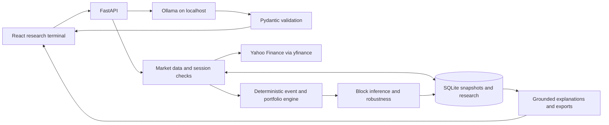

# Architecture

The production app serves a built React terminal and its FastAPI API from one loopback origin. SQLite is embedded in the Python service. The only inference endpoint is the local Ollama API. Vite is used during development and for the production build.



| Module | Responsibility |
| --- | --- |
| `stockreplay/schema.py`, `language.py`, `ai.py` | Validate experiment and model outputs, bind explicit literal amounts and horizons, request clarification or missing data, compose explanations from verified evidence |
| `market.py` | Normalize OHLCV, corporate actions and dates, identify required symbols, check NYSE sessions, download or read cached data |
| `indicators.py`, `engine.py` | Evaluate predefined logical conditions, execute realistic event or portfolio accounting and produce chart series |
| `statistics.py`, `robustness.py` | Time-block bootstrap, portfolio metrics, sensitivity grids and chronological evaluation |
| `store.py` | SQLite snapshots, run payloads, saved records, notes, model preference and comparison reports |
| `exports.py` | CSV, config JSON, self-contained HTML, portable snapshot bundles and checked import |
| `api.py` | Local API, bounded execution queue, health, experiment library, cached robustness/AI evidence and static frontend |
| `frontend/src/` | Typed React terminal, visual builder, charts, explorer, library, comparisons, data management and settings |
| `scripts/services.py` | Health-checked process startup, port selection, logging and scoped shutdown |

## Interpretation and explanation

Ollama receives the user’s question and the displayed defaults through `/api/chat` with a JSON schema, deterministic sampling settings and a fixed seed. Pydantic validates the model’s plan and the fully materialized experiment. Explicit signed price moves, named trigger symbols and unambiguous holding-period literals are bound during validation. A traded symbol must be grounded in the question through its exchange symbol or a recognized company name. Other company names prompt for their ticker. Two correction retries are available after the initial attempt. Unsupported data and unresolved questions have explicit response states. The builder exposes the actual JSON for review before running.

An experiment contains only whitelisted indicators, comparisons, typed fields and logical groups. The model cannot submit executable code, SQL, tools or remote URLs. At explanation time, the server builds supported assessments and alternative evidence clauses from computed results. The local model selects an assessment, phrasing and sequence. The renderer resolves the selected clauses against engine evidence. Invalid selections retry and then use an explicitly identified engine summary. There is no free-form numerical output path.

## Data and reproducibility

Each snapshot is identified by SHA-256 over its source identifier, ticker and canonical CSV bytes. SQLite stores compressed raw observations and acquisition metadata. Multiple versions of the same ticker and period can coexist. A run records the exact input hashes, resolved parameters, engine version, seed, prices, event ledger, metrics and chart data. Saved research links a name and notes to a completed run. Rerunning a compatible saved configuration reuses its pinned snapshots. A broader date range or another provider requires the corresponding inputs.

A portable `.stockreplay.json` file includes the experiment configuration, engine version and all required input series. Import checks structure, data checksums and OHLCV validity, then calculates a fresh run. The portable file contains JSON and CSV. Its checksum detects changed snapshot contents. Original vendor authentication requires a separate trusted source. Lockfiles fix dependency resolution for repeatable installation.

Interactive jobs expose queued, loading, calculating, completed and failed states. The service retains up to 128 recent status entries and persists completed runs in SQLite. Two worker threads execute runs with up to eight pending or active jobs. Queue status is process-local; after restarting, previously saved research can be reopened from SQLite.

## Development

```bash
.venv/bin/python -m uvicorn stockreplay.api:create_app --factory --host 127.0.0.1 --port 8765
# In a second terminal
npm --prefix frontend run dev
```

Vite proxies `/api` to the local backend. Lightweight Charts renders candlesticks, and a lazy-loaded Plotly basic bundle renders lines and histogram bars. Fonts and JavaScript assets are served locally. The application makes provider requests only for explicitly requested real data or online symbol searches.
