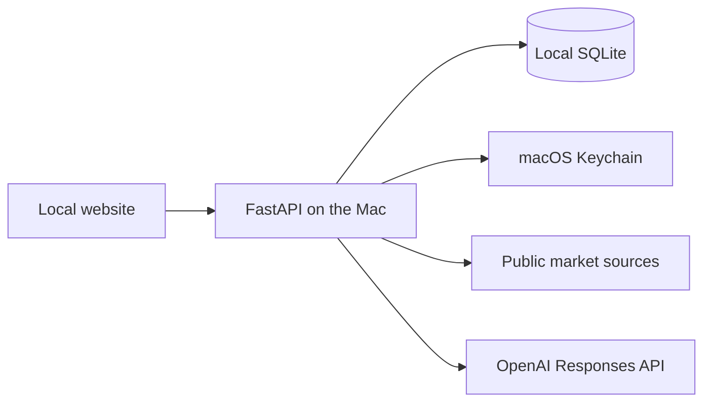

# Architecture

StockReplay serves React and FastAPI from a single loopback origin on macOS. Research, Watchlists and Portfolio share the same local service as Settings and the assistant.

`desk.py` assembles dated public observations from independent feeds. Each cache entry has a retrieval time, freshness state and source. `openai_research.py` handles generation testing, model discovery, research scores, validation and credential storage. Research prompts are built from a public-field allowlist. Scores and the evidence cited by the model are stored together. A missing optional feed can reduce the evidence available for a stock.

`assistant.py` describes the allowed product actions. The model returns structured operations and the browser dispatches them to the same local APIs used by the manual controls. Local portfolio calculations consume local account records and render in the chat. Destructive actions display a confirmation. Imports use the file selection and preview interfaces. The assistant can select a chart tool, place a dated drawing, change a layout, export bars, compare stocks and control replay.

The saved chat store uses revision-checked writes for its local transcripts. The assistant planner returns navigation destinations and typed product changes. Custom tabs persist ordered, validated widget descriptions in SQLite. Chat chart snapshots store immutable compressed price series keyed by their content. The news reader renders publisher-supplied excerpts and photos in the local UI. Bookmarked story metadata survives feed expiration.

`holdings.py` parses and previews statements, tracks revisions and applies reviewed account replacements in an SQLite transaction. `terminal_api.py` provides holdings, watchlists, charts, alerts, preferences and saved assessments. Older research runs and imports keep their on-disk formats and archive/export APIs. The current interface starts directly in stock research.

`setup.sh`, `start.sh` and `scripts/services.py` handle the macOS environment and the local process. `scripts/build_id.py` identifies the currently built checkout. [Installation](INSTALLATION.md) · [Data handling](DATA.md)
